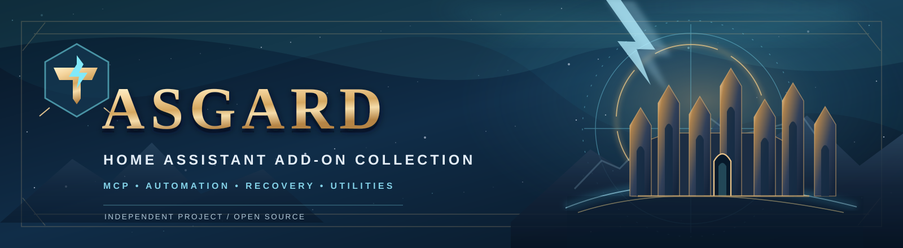
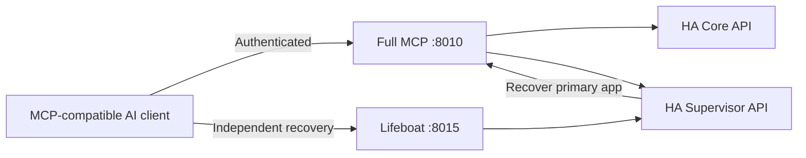

# Asgard Home Assistant Apps

[](https://github.com/minermartijn/Asgard_HA_AddOns/actions/workflows/ci.yml)
[](LICENSE)
[](https://www.home-assistant.io/)

**A collection of independently versioned Home Assistant apps**, with two MCP servers for AI-assisted home automation and app recovery, plus household utilities. Developed and maintained by [minermartijn](https://github.com/minermartijn).

## What is included?

| App | Version | Purpose |
| --- | --- | --- |
| **[HA Full MCP Server](ha_full_mcp/README.md)** | 1.11.1 | MCP tools for device/entity queries, automations, integrations, diagnostics, configuration, backups and app administration. |
| **[HA Addon MCP Server — Lifeboat](ha_addons/README.md)** | 1.4.0 | Separate MCP recovery path for app logs, lifecycle actions, and targeted app backup/restore. |
| **[Home Stock](home_stock/README.md)** | 1.0.0 | Household stock quantities, a shopping list, and Home Assistant integration. |
| **[Baby Tracker](baby_tracker/)** | 1.0.5 | Mobile-friendly feeding, diaper, sleep and growth tracking. |
| **[ASGARD Backup Inspector](asgard_backup_inspector/README.md)** | 0.1.0 | Read-only dashboard for Home Assistant backup metadata: count, freshness and known size (experimental). |

The app store reads each app's own `config.yaml` version. A GitHub Release is additional release documentation and does not replace the app store's update mechanism.

## Companion Home Assistant integrations

These are separate projects by the same maintainer, **not apps in this repository**. They are custom integrations installed through Home Assistant's Marketplace/HACS or manually into `custom_components/`; they will **not** appear when you add this repository to the Home Assistant app store.

| Integration | Purpose | Source and installation |
| --- | --- | --- |
| **[MyCurl](https://github.com/minermartijn/MyCurl)** | Creates sensors from HTTP/API responses, with presets and configurable data extraction. | [MyCurl repository](https://github.com/minermartijn/MyCurl) (separate custom integration) |
| **[MyMonitor](https://github.com/minermartijn/MyMonitor)** | HTTP endpoint/service status sensors and an accompanying dashboard history card. | [MyMonitor repository](https://github.com/minermartijn/MyMonitor) (separate custom integration; dashboard card needs maintenance) |

**Current code-review notes:** MyCurl executes configured curl commands through a system shell; use only trusted commands and URLs, and do not put secrets into command strings. MyMonitor's published dashboard card source currently contains unresolved Git conflict markers and should be fixed and rechecked in Home Assistant before relying on its card. The main Asgard apps do not depend on either integration.

## Published MCP releases

- **[HA Full MCP Server v1.11.1](https://github.com/minermartijn/Asgard_HA_AddOns/releases/tag/ha-full-mcp-v1.11.1)** — 62 configured tools for broad Home Assistant management.
- **[HA Addon MCP Server (Lifeboat) v1.4.0](https://github.com/minermartijn/Asgard_HA_AddOns/releases/tag/ha-lifeboat-v1.4.0)** — 22 focused app maintenance and recovery tools.

Both are independently installable Home Assistant apps; publishing a GitHub Release does not automatically deploy the update to a running Home Assistant instance.

## Why two MCP servers?

An AI assistant that updates the MCP app it is connected to can lose its own communication channel during a failed update. The **Lifeboat** app runs separately, so it may still be available to inspect logs or restart/rebuild Full MCP if the Home Assistant host and Supervisor remain operational.



This is not a replacement for conventional backups: Lifeboat cannot fix a failed host, broken Supervisor, or lost network. Read the [architecture and limitations](docs/ARCHITECTURE.md).

## Installation

You need a Home Assistant installation that supports **Apps**. See Home Assistant's current **Settings → Apps** area for the app store.

1. In Home Assistant, open **Settings → Apps → Install app → ⋮ → Repositories** and add a custom repository.
2. Add this repository URL:

   ```text
   https://github.com/minermartijn/Asgard_HA_AddOns
   ```

3. Refresh the app store if necessary and install only the apps you need.
4. Follow the app's README and configure its required credentials before connecting a client.
5. Test in a non-critical environment before relying on administrative or recovery operations.

**Important:** The MCP endpoints can administer Home Assistant. Never expose their ports directly to the public internet. Prefer header-based API key authentication, TLS/VPN or an authenticated access gateway, and restrict dangerous tools where possible. Read [SECURITY.md](SECURITY.md) before configuring remote access.

## Documentation

- [Full MCP usage and tool reference](ha_full_mcp/README.md)
- [Lifeboat installation, limitations and recovery](ha_addons/README.md)
- [Architecture and trust boundaries](docs/ARCHITECTURE.md)
- [Compare all 62 Full MCP and 22 Lifeboat tools](docs/MCP_TOOLS.md)
- [Reproducible recovery demonstration plan](docs/DEMO.md) — no published demo recording yet
- [Contributing and running regression tests](CONTRIBUTING.md)
- [Development and maintainer guide](docs/MAINTAINING.md)
- [Release procedure](docs/RELEASING.md)
- [Current roadmap](docs/ROADMAP.md)
- [Vulnerability reporting](SECURITY.md)

## Development and releases

Each top-level app has its own `config.yaml`, `Dockerfile`, and version. Source code and regression tests live within the relevant app directory.

The GitHub Actions CI workflow checks Python syntax, Home Assistant app metadata and existing MCP regression tests. Actual pass/fail results are shown in GitHub Actions; do not interpret an absent badge result as passing tests.

Release tags are **namespaced per app** and should be published only after version checks and relevant Home Assistant testing. Full MCP 1.11.1 and Lifeboat 1.4.0 have published GitHub Releases; Baby Tracker and Home Stock are not yet tagged.

## Help improve the project

Bug reports, documentation corrections, real-world testing feedback and focused pull requests are welcome. Please read [CONTRIBUTING.md](CONTRIBUTING.md). For security issues, use the private reporting guidance in [SECURITY.md](SECURITY.md), not a public issue.

Developed as an independent hobby project; compatibility and feature claims are based on documented code, and broader external adoption is not yet established.

---

Built with ⚡ by Asgard.

### Support my caffeine addiction ☕

If these apps saved you time (or a headache), feel free to fuel my next coding session! My code is powered by high-quality caffeine—one cup equals approximately three features and only one new bug. 😉

[](https://www.buymeacoffee.com/minermartijn)
