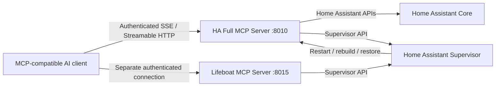
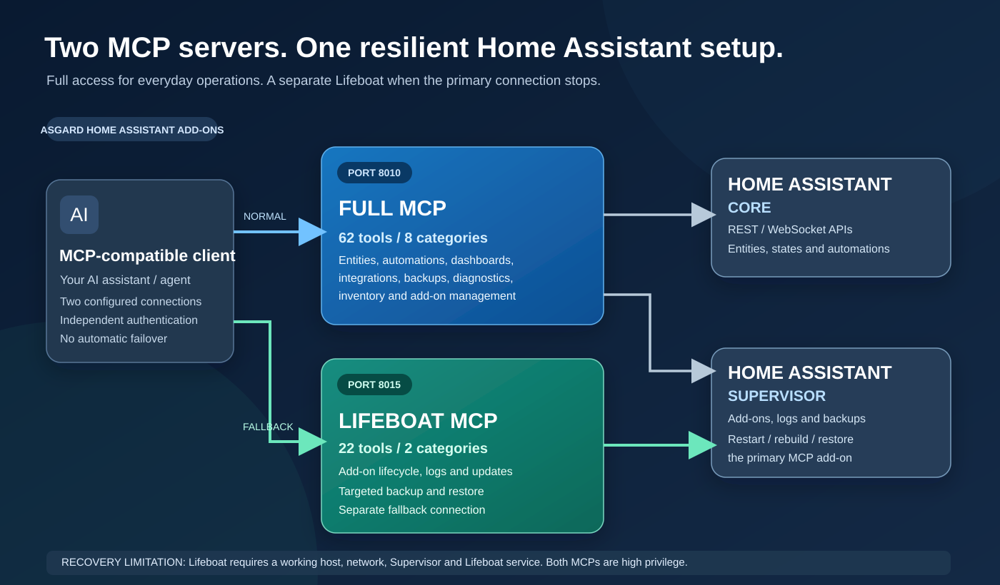

# Architecture: Full MCP and Lifeboat

Asgard's two MCP add-ons are separate servers. The Full MCP server offers the broad set of Home Assistant operations; Lifeboat focuses on add-on maintenance and recovery, keeping a second communication path available if the Full MCP add-on is unavailable.

## Shareable overview

For the complete verified tool catalogs (all **62 Full MCP** and **22 Lifeboat** tools), see [MCP_TOOLS.md](MCP_TOOLS.md).

## Design principles

- **Independent add-ons:** The two MCP servers run as separate add-ons and can be updated separately.
- **Distinct credentials:** Use different long, randomly generated API keys for Full MCP and Lifeboat. Never include real credentials in examples, recordings, issues or commits.
- **Least privilege:** Full MCP exposes administrative and configuration-changing actions; disable unnecessary tools. Lifeboat also has powerful add-on administration capabilities.
- **Recovery after a failed update:** If Full MCP crashes or fails to restart but Home Assistant Supervisor, the host, the network, and Lifeboat are still operational, an authorized client can use Lifeboat to inspect logs and repair the add-on.
- **No magic fallback:** Lifeboat will not recover a complete host outage, broken Supervisor, or loss of network connectivity. Maintain standard Home Assistant backups and recovery access.

## Supported connections

Both MCP servers document SSE and Streamable HTTP. Prefer authentication headers and TLS/VPN or an authenticated gateway. Path/query API keys exist for client compatibility but may leak through access logs. Read [SECURITY.md](../SECURITY.md).

## Further details

- [Full MCP server](../ha_full_mcp/README.md)
- [Lifeboat MCP server](../ha_addons/README.md)
- [Releases and versioning](RELEASING.md)
