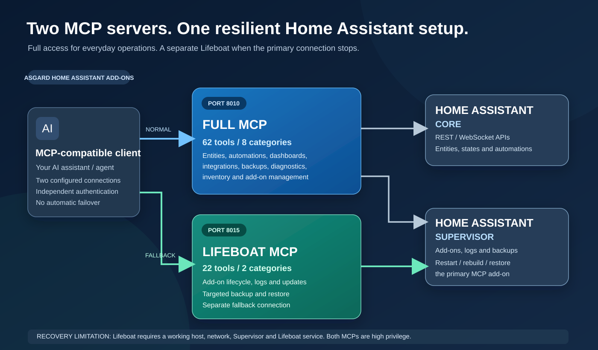

# Home Assistant community outreach

**Published Home Assistant forum discussion (2026-11-09):** [Two MCP servers for Home Assistant — 62 tools and an independent recovery Lifeboat](https://community.home-assistant.io/t/add-on-two-mcp-servers-for-home-assistant-62-tools-an-independent-recovery-lifeboat/1033525/1).

The forum topic was published by the maintainer. Its view count, replies and independent installation outcomes have **not** been independently verified here.

The text below is retained as the original *draft/reference*, not as an exact copy of the published post. It has not been posted elsewhere by this repository.

## Original announcement drafts

## Best destination: Home Assistant Community → Share your Projects!

**Forum category:** https://community.home-assistant.io/c/projects/9

The official Home Assistant app-development documentation recommends this category for introducing community-developed add-ons. Don't submit these MCP servers as "Custom Integrations" — they are Supervisor add-ons.

### Suggested topic title

**[Add-on] Two MCP servers for Home Assistant: 62 tools + an independent 22-tool recovery Lifeboat**

### Ready-to-edit forum post

Hey everyone!

I've been building a couple of Home Assistant add-ons to connect MCP-compatible AI assistants to my Home Assistant installation. I wanted to share them and get feedback from people who also use MCP or automate their Home Assistant setup.

There are **two separate servers**, and that is intentional:

**1. HA Full MCP Server (v1.11.1)** — **62 tools on port 8010**, covering entities, services, integrations, automations, dashboards, diagnostics, registry inventory, backups and add-on management. It's the everyday management connection.

**2. HA Addon MCP Server / Lifeboat (v1.4.0)** — **22 tools on port 8015**, limited to add-on/Supervisor operations: logs, start/stop/restart, updates, reinstall/rebuild, configuration, and targeted single-add-on backups and restores.

**Why two?** If the assistant updates or restarts the Full MCP add-on and that service fails to come back, it loses its own primary connection. Lifeboat runs as a separate add-on with its own endpoint and credentials. As long as the host, network, Supervisor and Lifeboat are still running, the assistant can switch to Lifeboat to inspect logs and attempt a recovery.

It is **not automatic failover**, and it won't help if the entire host or Supervisor goes down.

### Architecture at a glance

**Features:** SSE + Streamable HTTP, independent add-ons, configurable tool permissions on Full MCP, and support for `amd64` and `aarch64`.

**Installation:** Add this repository through Home Assistant's add-on store's custom repositories, then install either or both add-ons:

https://github.com/minermartijn/Asgard_HA_AddOns

**Full tool lists (62 + 22):** https://github.com/minermartijn/Asgard_HA_AddOns/blob/main/docs/MCP_TOOLS.md

**Security note:** Both servers can perform high-privilege actions. Please **don't expose their ports directly to the internet**. Use a trusted network/VPN or secured access gateway, protect credentials, and require human approval before destructive operations. Lifeboat is a recovery helper, not a backup replacement.

Both add-ons work in my own installation, and the existing regression tests are passing. I haven't yet tested all combinations of clients and Home Assistant installations.

I'd especially like feedback on:
- Whether the separate Lifeboat is useful for your setup.
- Which MCP clients you're using and how they handle reconnects after add-on restarts.
- Anything missing from the tool catalogs or installation instructions.

Happy to hear suggestions, bug reports or contributions.

## Shorter Reddit version

**Suggested title:** I built two Home Assistant MCP add-ons — one with 62 tools, another as a separate recovery Lifeboat

I ran into a practical problem: if an AI assistant restarts/updates the MCP server it's connected through and that service fails to return, the assistant can't use that connection to fix it.

I built two separate Home Assistant add-ons:

- **Full MCP (v1.11.1)** — 62 tools for entities, automations, backups, dashboards, integrations, add-ons and diagnostics (port 8010).
- **Lifeboat MCP (v1.4.0)** — 22 add-on/Supervisor tools for logs, updates, restart/rebuild, and targeted backup/restore (port 8015).

A client can configure both as independent MCP connections, so Lifeboat may still be usable if Full MCP crashes. It doesn't help if Home Assistant's host/Supervisor/network is down, and the switch isn't automatic.

Both currently work in my own HA installation. Available as open-source add-ons here:

https://github.com/minermartijn/Asgard_HA_AddOns

The architecture diagram and full tool lists are in the README/docs. Both endpoints are high privilege, so please use a trusted network or properly secured gateway; don't expose the ports directly.

I'd love feedback from anyone running MCP alongside Home Assistant, particularly on the independent recovery approach.

*Check the current rules and self-promotion guidance of any subreddit before posting, and don't post the same promotional text repeatedly across communities.*

## Additional developer-focused venue

The Home Assistant Discord **#developers** channel is useful for asking concrete technical questions about add-on design. Ask a focused question about Supervisor recovery and add-on isolation rather than pasting the entire promotional post. The official Home Assistant Contributors pages explain how to join the relevant channels.

## Maintenance expectations

Once posted, watch for installation questions and respond to real feedback. Link to public bug issues and publish tested updates; do not fabricate stars, installs, reviews or endorsements.
