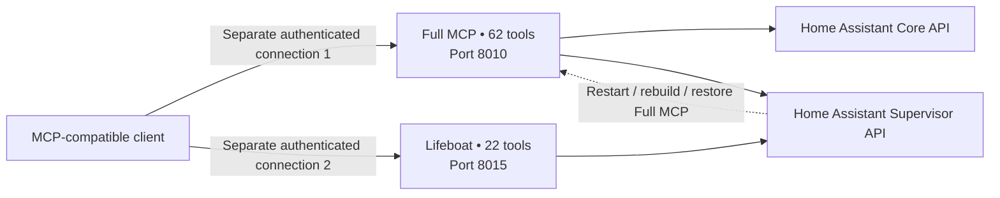

# MCP tool catalogs and recovery architecture

**Verified against the code and app manifests on 2026-11-09.** These are the **available tool definitions**, not a claim that every tool is enabled in every installation or that each action is safe to execute autonomously.

| | Full MCP | Lifeboat |
| --- | --- | --- |
| App version | `1.11.1` | `1.4.0` |
| MCP tools | **62** across 8 areas | **22** across 2 areas |
| Default TCP port | **8010** | **8015** |
| Main purpose | Broad Home Assistant control and diagnostics | Independent app maintenance and recovery |
| Home Assistant APIs | Home Assistant Core + Supervisor | Mainly Supervisor |
| Connection | Separate authenticated SSE / Streamable HTTP MCP endpoint | **Separate** authenticated SSE / Streamable HTTP MCP endpoint |
| Entity, automation and dashboard tools | Yes | No |
| Update / restart / rebuild apps | Yes | Yes |
| Backup tools | General backup operations | Targeted single-app backups |
| Survives a failed Full MCP process | No (it **is** the failed process) | Potentially yes, while the host, network, Supervisor and Lifeboat are healthy |

## Full MCP (62 tools)

| Category | Count | Exact tool names |
| --- | ---: | --- |
| **Apps & system** | 22 | `list_addons`, `get_addon_info`, `get_addon_logs`, `start_addon`, `stop_addon`, `restart_addon`, `update_addon`, `install_addon`, `uninstall_addon`, `get_addon_configuration`, `set_addon_configuration`, `validate_addon_configuration`, `rebuild_addon`, `list_store_addons`, `reload_addons`, `check_addon_availability`, `get_supervisor_logs`, `get_homeassistant_logs`, `restart_homeassistant`, `read_config_file`, `write_config_file`, `check_config` |
| **Backups** | 5 | `create_backup`, `list_backups`, `get_backup_info`, `restore_backup`, `delete_backup` |
| **Integrations** | 4 | `list_integrations`, `reload_integration`, `get_integration_info`, `remove_integration` |
| **Entities & services** | 6 | `list_entities`, `get_entity_state`, `set_entity_state`, `call_service`, `get_services`, `get_entity_history` |
| **Registry inventory** | 3 | `list_areas`, `list_devices`, `list_config_entries` |
| **Dashboards** | 4 | `list_dashboards`, `get_dashboard_config`, `create_dashboard`, `delete_dashboard` |
| **Automations** | 8 | `list_automations`, `get_automation`, `create_automation`, `update_automation`, `delete_automation`, `enable_automation`, `disable_automation`, `trigger_automation` |
| **Diagnostics** | 10 | `get_system_health`, `get_error_log_summary`, `list_unavailable_entities`, `get_recorder_stats`, `check_network_connectivity`, `list_custom_components`, `get_startup_time_breakdown`, `validate_all_automations`, `list_deprecated_features`, `get_integration_diagnostics` |

## Lifeboat (22 tools)

| Category | Count | Exact tool names |
| --- | ---: | --- |
| **App maintenance** | 18 | `list_addons`, `get_addon_info`, `start_addon`, `stop_addon`, `restart_addon`, `get_addon_logs`, `update_addon`, `install_addon`, `uninstall_addon`, `get_addon_configuration`, `set_addon_configuration`, `validate_addon_configuration`, `rebuild_addon`, `list_store_addons`, `reload_addons`, `check_addon_availability`, `get_supervisor_logs`, `restart_homeassistant` |
| **Single-app backup/restore** | 4 | `create_addon_backup`, `list_backups`, `get_backup_info`, `restore_addon_backup` |

## Why there are two MCP apps

The **primary connection** gives a client access to Home Assistant's devices, entities, automations, dashboards, integrations, system information and apps. It is useful for normal operation.

The **Lifeboat connection** is intentionally **installed and configured independently**. If the primary app stops because of a problematic update or configuration, Lifeboat may still let the client inspect the primary app's logs, restart/rebuild it, or restore a backup. Having a second MCP service does **not** automatically switch your client over: configure both connectors in the client and use the recovery one explicitly when required.

**Recovery prerequisites:** Home Assistant host, Supervisor, network access, and Lifeboat must all still work. This approach cannot recover a total machine outage, broken Supervisor, or loss of networking. Keep independent/manual access and backups.

## Typical use cases

**Full MCP**
- "List unavailable entities and identify relevant diagnostics."
- "Inspect which automation runs in the morning." (read-only)
- "Update an automation or call a service." (modifying action — requires care)
- "Get the current app status and available backups."

**Lifeboat**
- "The primary MCP app no longer responds; check its state and logs."
- "Restart or rebuild the primary MCP app using the Supervisor."
- "Before an update, make a targeted backup of that app."
- "Restore the affected app from a verified backup." (destructive operation — confirm first)

## Deployment and security

**Both servers are high privilege** even though Lifeboat has fewer tools. Restrict both endpoints to trusted networks, use TLS/VPN/access gateways where appropriate, and prefer header-based API-key authentication rather than keys in URLs. Separating the services is a *recovery design*, not a security sandbox.

Tool calls in Full MCP 1.11.1 respect disabled-tool settings at execution time. Read [security guidance](../SECURITY.md) and the [maintainer notes](MAINTAINING.md) before exposing the servers remotely.

This tool list was cross-checked with the actual source-defined tool registrations; it should be refreshed whenever a release changes the tool catalog.
